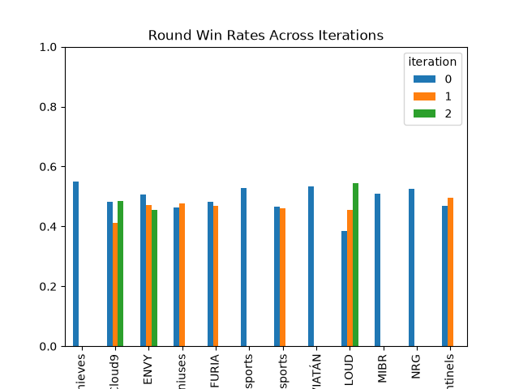
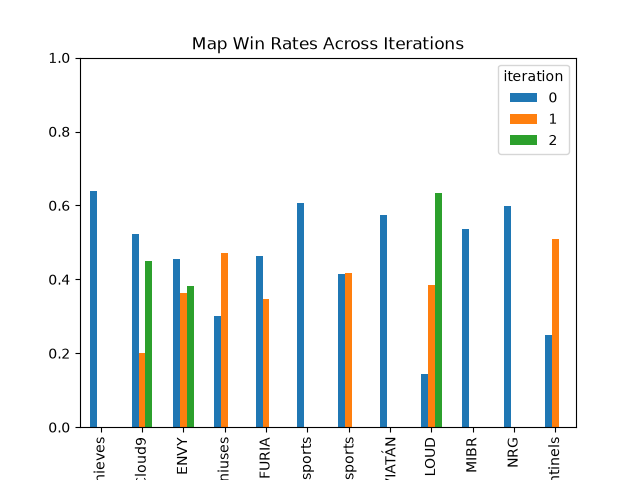
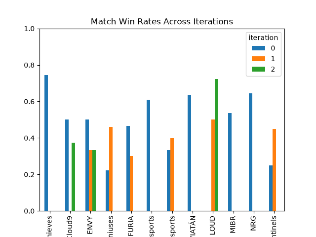

# The mid-season roster change gambit

Does swapping players in the middle of the competitive seeason help teams find the missing piece or make them completely fall apart?

## Introduction

I love esports, and as a data scientist, I love analyzing its data. We've seen for literal decades now that data analysis can be a huge help in making a team successful, and while there's definitely a good amount of data analysis in esports, I think it can be pushed further. I wanted to see in this project if it was possible to find the answer to a question that is generally regarded as a pure judgement call.

## Motivating question

In professional VALORANT, teams are comprised of 5 players and a coach, with some other optional roles. Generally, organizations remove and add players to their lineup during the offseason, because that is when the contracts of their own players and those of other organizations are expiring. Furthermore, this time is great to make changes becuase there's no important matches. This means they can experiment, build trust and unity as a team, and work out any problems that might arise from making changes. This "transfer window" usually lasts 2-3 months, and each team tries to pick up the best 5 players available for their goals to form a cohesive team by the time the official games start back up. 

In an ideal world, these 5 players learn to work together, become a competent team, and start winning, hopefully bringing home a trophy. However, the truth is that some teams are not going to see the success they were seeking with their roster. This brings up a challenging question: should they stick together, building off the chemistry they already have, and hopefully work out the kinks? Or should one player (or more!) be swapped out for another player who apparently wasn't good enough during the offseason to get a spot? It's a difficult dilemma, and one without a clear consensus. I hope the data will help show some evidence for what might be the better decision.

## Ethics

The documentation of the package declares that it has built-in rate limiting to respect the website and not overwhelm it. However, I also found that in the website's terms of service that automated scraping is not allowed. Seeing this, I have created a discussion on the package's repo to ask its author if they have consulted with the developers of the website. I ultimately decided that this project was reasonable to carry out, because of the rate-limiting and my plans to only requisition data once.

## Summary of steps used

This project was made possible by the package [vlrdevapi](https://github.com/Vanshbordia/vlrdevapi), which is a python package that scrapes the website vlr.gg and returns its info as typed objects. A quick read of the docs and some poking around via a python console gives you a pretty good idea of how to use the package and the data it retrieves. For this process, I used the defined objects to obtain the 12 teams that participated in the VCT Americas league in the 2026 season, fetched their match histories, and their roster move histories. I then saved this data to a csv file using pandas.

## EDA highlights

The matches dataframe came out to 361 observations across 12 different teams, averaging to just over 30 matches per team. Some quick aggregate functions then yielded this dataframe of season-long stats by team:

| Name          | matches_played | match_winrate | map_winrate | round_winrate |
|---------------|---------------:|--------------:|------------:|--------------:|
| Sentinels     |             24 |        41.67% |      47.46% |        49.10% |
| 100 Thieves   |             39 |        74.36% |      64.00% |        55.00% |
| Cloud9        |             22 |        36.36% |      43.40% |        47.04% |
| ENVY          |             22 |        36.36% |      38.89% |        47.35% |
| NRG           |             48 |        64.58% |      59.84% |        52.61% |
| KRÜ Esports   |             22 |        36.36% |      41.51% |        46.40% |
| LEVIATÁN      |             33 |        63.64% |      57.47% |        53.30% |
| FURIA         |             25 |        40.00% |      41.79% |        47.60% |
| Evil Geniuses |             22 |        36.36% |      40.74% |        47.15% |
| LOUD          |             31 |        58.06% |      51.22% |        50.20% |
| MIBR          |             28 |        53.57% |      53.52% |        50.91% |
| G2 Esports    |             46 |        60.87% |      60.68% |        52.89% |

*Matches are each time two teams face each other. Matches are played Best of 3 maps, and each map is first to 13 rounds, with a win by two overtime.*

While the average sits at around 30, the median is at 26.5. This shows the kind of "rich-get-richer" effect with match counts: Teams who win go deeper in tournaments, meaning they play more. This makes the match counts top heavy, where the high numbers are concentrated in a few successful teams, which drags the average up. NRG, G2, and 100 Thieves all attended several international events, while Cloud 9, Evil Geniuses, Envy, and KRU didn't make any.

100 Thieves manage to claim the top spot in all three winrate columns, which reflects the large amounts of success this year; they won one domestic and one international trophy. The low match winrates of the bottom teams mentioned earlier make sense; they weren't going to the international events because they weren't winnning.

Another really interesting trend is that the finer the grain of the win percentage, the closer it gets to 50. Teams who lost lots of matches have higher round win rates, and teams who won their matches have lower round winrates. This shows that it's easier to consistently win matches than it is to win rounds. This is the top level of play, so most matches are at least competitive, rather than blowouts.

Next I grabbed the roster moves of each team. After removing moves outside of the 2026 season and refining some strings, I was left with this dataframe, with one roster action per row:

| team_id | team | date | player_name | action_type |
|---:|---|---|---|---|
| 188 | Cloud9 | 2026-07-10 | v1c | Join |
| 188 | Cloud9 | 2026-07-10 | Notexxd | Leave |
| 188 | Cloud9 | 2026-05-29 | FireBallOps | Join |
| 188 | Cloud9 | 2026-05-29 | Xeppaa | Leave |
| 188 | Cloud9 | 2026-05-08 | Notexxd | Join |
| 188 | Cloud9 | 2026-05-08 | v1c | Leave |
| 188 | Cloud9 | 2026-05-02 | Jackk | Join |
| 188 | Cloud9 | 2026-05-01 | penny | Leave |
| 5248 | Evil Geniuses | 2026-07-06 | C0M | Leave |
| 5248 | Evil Geniuses | 2026-07-06 | Okeanos | Leave |
| 5248 | Evil Geniuses | 2026-05-07 | Paincakes | Join |
| 5248 | Evil Geniuses | 2026-05-07 | zerona | Join |
| 5248 | Evil Geniuses | 2026-05-07 | C0M | Inactive |
| 5248 | Evil Geniuses | 2026-05-07 | Okeanos | Inactive |
*Truncated to just the first two teams' moves*

However, these roster actions don't happen in isolation. When a player leaves, someone has to join to fill their place. The way VLR dates roster moves is via social media posts. However, it's very often that these organizations will post across several days to increase engagement, meaning I can't just group by date. I decided to group by month, which I felt was enough time to say a new roster had formed and was moving forward. With some concatenation and +/- to represent joining/leaving, I got this dataframe: 

| month | team | team_id | date | changes |
|---:|---|---:|---|---|
| 2 | ENVY | 427 | 2026-02-05 | -Inspire, +Demon1 |
| 3 | LOUD | 6961 | 2026-03-04 | -pANcada, +erde |
| 3 | Sentinels | 2 | 2026-03-06 | +Jerrwin, -Kyu, -N4RRATE, +JonahP |
| 5 | Cloud9 | 188 | 2026-05-01 | +FireBallOps, -Xeppaa, +Notexxd, -v1c, +Jackk, -penny |
| 5 | Evil Geniuses | 5248 | 2026-05-07 | +Paincakes, +zerona, -C0M, -Okeanos |
| 6 | ENVY | 427 | 2026-06-30 | -P0PPIN, +GLYPH |
| 6 | KRÜ Esports | 2355 | 2026-06-24 | +heat, -silentzz |
| 7 | Cloud9 | 188 | 2026-07-10 | +v1c, -Notexxd |
| 7 | FURIA | 2406 | 2026-07-01 | +C0M, -eeiu, +Shyy, +basic, -basic |
| 7 | LOUD | 6961 | 2026-07-14 | +DaviH, -Virtyy |
*Theres still some hiccups present, like the +basic, -basic in the second to last row, but for our purposes this will work*

Next, I joined this dataframe to the match dataframe, and creating a column that denoted what "iteration" of the roster was playing for that match. Then I grouped by team and iteration, aggregating on the winrates:

| team_id | iteration | Name | matches_played | match_winrate | maps_won | rounds_won | maps_lost | rounds_lost | map_winrate | round_winrate |
|---:|---:|---|---:|---:|---:|---:|---:|---:|---:|---:|
| 2 | 0 | Sentinels | 4 | 25.00% | 2 | 89 | 6 | 101 | 25.00% | 46.84% |
| 2 | 1 | Sentinels | 20 | 45.00% | 26 | 535 | 25 | 546 | 50.98% | 49.49% |
| 120 | 0 | 100 Thieves | 39 | 74.36% | 64 | 1160 | 36 | 949 | 64.00% | 55.00% |
| 188 | 0 | Cloud9 | 10 | 50.00% | 12 | 243 | 11 | 260 | 52.17% | 48.31% |
| 188 | 1 | Cloud9 | 4 | 0.00% | 2 | 87 | 8 | 124 | 20.00% | 41.23% |
| 188 | 2 | Cloud9 | 8 | 37.50% | 9 | 202 | 11 | 215 | 45.00% | 48.44% |
| 427 | 0 | ENVY | 4 | 50.00% | 5 | 130 | 6 | 126 | 45.45% | 50.78% |
| 427 | 1 | ENVY | 9 | 33.33% | 8 | 219 | 14 | 245 | 36.36% | 47.20% |
| 427 | 2 | ENVY | 9 | 33.33% | 8 | 195 | 13 | 234 | 38.10% | 45.45% |
| 1034 | 0 | NRG | 48 | 64.58% | 76 | 1420 | 51 | 1279 | 59.84% | 52.61% |
| 2355 | 0 | KRÜ Esports | 12 | 33.33% | 12 | 281 | 17 | 322 | 41.38% | 46.60% |
| 2355 | 1 | KRÜ Esports | 10 | 40.00% | 10 | 221 | 14 | 258 | 41.67% | 46.14% |
| 2359 | 0 | LEVIATÁN | 33 | 63.64% | 50 | 952 | 37 | 834 | 57.47% | 53.30% |
| 2406 | 0 | FURIA | 15 | 46.67% | 19 | 401 | 22 | 433 | 46.34% | 48.08% |
| 2406 | 1 | FURIA | 10 | 30.00% | 9 | 264 | 17 | 299 | 34.62% | 46.89% |
| 5248 | 0 | Evil Geniuses | 9 | 22.22% | 6 | 207 | 14 | 241 | 30.00% | 46.21% |
| 5248 | 1 | Evil Geniuses | 13 | 46.15% | 16 | 338 | 18 | 370 | 47.06% | 47.74% |
| 6961 | 0 | LOUD | 3 | 0.00% | 1 | 56 | 6 | 90 | 14.29% | 38.36% |
| 6961 | 1 | LOUD | 10 | 50.00% | 10 | 246 | 16 | 296 | 38.46% | 45.39% |
| 6961 | 2 | LOUD | 18 | 72.22% | 31 | 570 | 18 | 479 | 63.27% | 54.34% |
| 7386 | 0 | MIBR | 28 | 53.57% | 38 | 752 | 33 | 725 | 53.52% | 50.91% |
| 11058 | 0 | G2 Esports | 46 | 60.87% | 71 | 1308 | 46 | 1165 | 60.68% | 52.89% |
*A 0 in iteration means the roster the team started with at the beginning of the year; a 1 means after one change, 2 after two, etcetera.*

Finally, we get to our visualization showing each roster iteration's winrates, across matches, maps, and rounds.

So let's remember our original question: Do roster changes create success? The truth is that there is evidence for both. Teams like Cloud 9, Envy, and Furia all have noticeably lower match win rates in their later rosters. However, teams like LOUD and Sentinels got visibly better. LOUD is of particular note, as their "0", or start of year roster, had a 0% match winrate, but ended up winning the biggest tournament of the year after their two changes. One more group to take into account are teams like G2, NRG, 100 Thieves, Leviatan, and MIBR, who all made no changes. With the exception of the trophy winning LOUD iteration, they have the highest winrates. This might suggest that sticking together is the best move. Then again, rosters who are winning don't need to make changes. While this was a good start to exploring, our EDA hasn't quite proven enough either way to let us have a solid conclusion. In the future, it'd be great to include the other regions of VCT and do multiple years to get a large overview of the effects of roster changes. It'd also be interesting to compare performance of x games after a change, or compare the stats of the new players vs those they replaced.

Thank you for reading!

A link to the repo of the code used for this analysis can be found [here](https://github.com/emarler45/data_acquisition_blog_scripts)