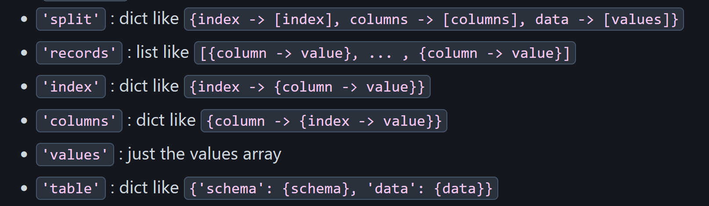

# Introduction

Pandas is one of the most useful python packages we have access to in data scicence. The objects it uses (Series, DataFrames, and more) make working with data super easy and intuitive! As a STAT 386 student, you should already have a solid grasp on the main concepts and tools available to you. The purpose of this tutorial is to show off some of the secrets buried in the package that can make some workflows much easier! These tips are split up into 3 sections, covering 3 important steps of working with data: importing, cleaning, and manipulating. Let's get to it!

```{python}
import pandas as pd
```

# Importing Tips & Tricks

Importing your data is the start of your work, but it's critical. If you can't import correctly, you can't even get going! While most data you import will probably come from some sort of separated value document, it can be helpful to know that pandas knows how to read more than just those! I'll introduce you to two other importing functions that mightbe of use, one for a format you're quite likely to encounter at some point, and one that is more helful for quick one-offs.

## read_json()

[Pandas docs](https://pandas.pydata.org/docs/reference/api/pandas.read_json.html)

Everyone knows that **read_csv** is an easy way to import some data. But what if instead of your data looking like this:
```{csv}
data.csv
,Date,Username,seed_type,dragon_death,winner,elo_before,elo_after
0,Jan  1 2026 20:39:00,autoqualler,DESERT_TEMPLE,,False,1620,1601
1,Jan  1 2026 20:39:00,7rowl,DESERT_TEMPLE,504.349,True,1657,1676
2,Jan  1 2026 21:11:12,7rowl,DESERT_TEMPLE,,False,1671,1648
```

It looked like this:
```{json}
data.json
{
    "Date": {
        "0":1767299940000,
        "1":1767299940000,
        "2":1767301872000
        },
    "Username": {
        "0":"autoqualler",
        "1":"7rowl",
        "2":"7rowl"
        },
    "seed_type": {
        "0":"DESERT_TEMPLE",
        "1":"DESERT_TEMPLE",
        "2":"DESERT_TEMPLE"
        },
    "dragon_death": {
        "0":null,
        "1":504.349,
        "2":null
        },
    ...
}

```

JSON is one of the most widely used formats across the whole internet. You can find it in HTTP requests, config files, API exchanges, and notably for us, databases. Extracting data out of this format manually would involve a lot of loops and key lookups; luckily, pandas has already done the work for us! The function **read_json** gladly accepts data of this format and returns it as a glorious DataFrame!
```{python}
json_demo = 'tutorialdata/data.json'
pd.read_json(json_demo)
```

Only one argument is required, that being the file path of the data you want to read in. One optional argument I do want to highlight is **orient**. This informs the function the structure of your json. Here's a list of a couple options and their formats from the documentation (linked above).



So, when you inevitably come across JSON data that you want to analyze, remember pandas already has you covered.

## read_clipboard()

[Docs link](https://pandas.pydata.org/docs/reference/api/pandas.read_clipboard.html)

Let's say you're reading some other tutorial and you want to replicate some demonstration for yourself, just to check it out. Normally, you'd have to download their data files, or find or create your own data. That can create clutter or otherwise be messy, and probably doesn't feel worth the hassle. Well, as long as you can Ctrl+C, you're in luck! Wtih **read_clipboard**,Pandas can read text right off your clipboard and turn it into a DataFrame, as long as there's a discernible structure.

Give it a try! Copy this here simple csv list you saw earlier:
```{csv}
,Date,Username,seed_type,dragon_death,winner,elo_before,elo_after
0,Jan  1 2026 20:39:00,autoqualler,DESERT_TEMPLE,,False,1620,1601
1,Jan  1 2026 20:39:00,7rowl,DESERT_TEMPLE,504.349,True,1657,1676
2,Jan  1 2026 21:11:12,7rowl,DESERT_TEMPLE,,False,1671,1648
3,Jan  1 2026 21:11:12,JackoWacko62,DESERT_TEMPLE,498.281,True,1596,1619
4,Jan  1 2026 21:32:36,JackoWacko62,RUINED_PORTAL,504.775,True,1599,1622
5,Jan  1 2026 21:32:36,7rowl,RUINED_PORTAL,,False,1668,1645
6,Jan  1 2026 21:42:59,7rowl,BURIED_TREASURE,494.458,True,1645,1663
7,Jan  1 2026 21:42:59,7astrid,BURIED_TREASURE,,False,1592,1574
8,Jan  1 2026 21:53:52,v_strid,VILLAGE,,False,1603,1585
9,Jan  1 2026 21:53:52,7rowl,VILLAGE,553.354,True,1663,1681
10,Jan  1 2026 22:28:12,7rowl,VILLAGE,,True,1681,1698
```

Now go to a project with pandas installed, open a python console, and run the command `pd.read_clipboard(',')`.

Neat, right? This is super helpful if you ever find yourself looking at data in a program separate to your python IDE and want to do a little analysis. While no parameters are needed, it's important to take note of **sep**. This takes a regex expression that will let pandas know what the separator between values is. The default is whitespace, but you can set it to anything, like a comma in the example above.

One last note with these import tricks: they have their respective *export* functions as well! If you need, pd.to_json() and pd.to_clipboard() work in a much similar fashion as other export functions, just in the desired format!

# Cleaning Tips & Tricks

Cleaning, while not *technically* necessary, takes data analysis from cursory to professional. It might be lengthy, and boring, but it saves so much extra code, time, and frustration during analysis. Hopefully, these two tricks can help you speed up the process just a little more next time you have to do some chores.

## pd.Categorical

[Docs link](https://pandas.pydata.org/docs/reference/api/pandas.Categorical.html)

Did you know that Pandas adds more classes than just the Series and the DataFrame? It's true! One such object is the **Categorical**. This nifty guy can define the options for a categorical variable, which is a common occurence in data. This way, entries in your category column are their own data type, instead of integer, string, or otherwise. 

```{python}
df = pd.read_csv('tutorialdata/data.csv')

# Here, seed_type is a categorical variable; it can only be one of 5 values
df["seed_type"]
```

```{python}
# Redefining the column with the Categorical class wrapped around it makes it so that the values fall into distinct categories
df["seed_type"] = pd.Categorical(df["seed_type"])
df["seed_type"]

```

One case where this becomes extremely useful is when the category is ordered or hierarchical. If your category is represented by text, sorting usually doesn't fair so well:

```{python}
# Let's say I want to rank the seeds by my personal preference: Buried Treasure, Shipwreck, Ruined Portal, Village, Desert Temple
# In its current state, the seeds will rank alphabetically
df.sort_values("seed_type")
```

 Upon initializing a Categorical, you can add the parameter `ordered=True` to set the order. This method requires *categories*, a list with the categories in order from highest to lowest. Now you can call **sort_values** on the category and it will work!

```{python}
df["seed_type"] = pd.Categorical(df["seed_type"], ordered=True, 
                                categories=["BURIED_TREASURE", "SHIPWRECK", "RUINED_PORTAL", "VILLAGE", "DESERT_TEMPLE"])
df.sort_values("seed_type")
```

 Categorical data is common and useful, so make sure to make the most of it when using pandas by employing the Categorical class!

## Series methods

Thankfully, Pandas has made working with columns of DataFrame/Series really intuitive. You can use the normal sign operators between them, like +, -, *, /, %, ^, and more. However, did you know that you can also represent these operations with methods? Here's that same list I gave, but in method form:

- .add()
- .sub()
- .mul()
- .div()
- .floordiv()
- .mod()
- .pow()

On their own, they're not particularly helpful or interesting. However, there's two hidden features I'd like to spotlight.

For the first, there's once again an optional argument I'd like to call attention to: *fill_value*. In the case that missing values have been left in the dataset, this parameter substitutes your passed in value for the missing value when performing the operation. It's effectively a **fillna** for just a moment.

```{python}
# Note how you can also use constants!
df["dragon_death"].sub(90, fill_value=0)
```

Secondly, functions are evaluated as they are called, meaning that order of operations doesn't have to be accounted for: you can just call each method one right after the other.

```{python}
# This doesn't work; you need parentheses around the subtraction for it to go first
elo_change_pct = df["elo_after"] - df["elo_before"] / df["elo_after"]

# Here, the operations are evaluated one after the other, like in a calculator
elo_change_pct = df["elo_after"].sub(df["elo_before"]).div(df["elo_after"])
elo_change_pct
```

Hopefully you now feel more confident and prepared to clean your data, particularly when dealing with categorical variables and columnwise operations!

# Manipulation Tips & Tricks

Now this is where the good stuff is. Manipulating the data is where you get to start putting in your own ideas and deriving insights from the data. It's exciting, and the driving part of data science! As you move, create, and impute data, I've go two more tips to help you do that.

## pd.NamedAgg()

[Docs Link](https://pandas.pydata.org/docs/reference/api/pandas.NamedAgg.html)

Another class coming at you, this one called **NamedAgg**! This takes an aggregation that you might make in a DataFrame and assigns it to a variable, or in other words, gives it a name. This way, you can then call that variable when aggregating your DataFrame. This can allow you to use the same aggregation across multiple DataFrames. Furthermore, and in my opinion more useful, is that it makes your code more readable for a demo, like in a notebook.

```{python}
# Here we can define our aggs, with descriptive and recognizable names
elomaxagg = pd.NamedAgg("elo_after", "max")
eloavgagg = pd.NamedAgg("elo_after", "mean")

# then we can take a break, perhaps explain another concept..ConnectionAbortedError

# and now we can return to the aggregation, and use our NamedAggs to do so!
grouped = df.groupby("Username").agg(
    max_elo = elomaxagg,
    avg_elo = eloavgagg
)
grouped.round().head(10)
```

This one's simple, but that's part of its greatness!

## reset_index()

[Docs page](https://pandas.pydata.org/docs/reference/api/pandas.DataFrame.reset_index.html)

This one might honestly be my favorite. I've used it numerous times in actual projects. We all know that **sort_values** will change the order of the appearance of the rows, showing according to the specified column(s). However, the index values for these rows will remain the same, even if you save the sorted DataFrame to a new name. This is where the method **reset_index** comes to the rescue! This function returns an identical DataFrame, except that the row indexes now start at 1 and go up, esentially setting the default state of the DataFrame to the sorted version.

```{python}
#Notice how here the indexes jump around, even after saving the DataFrame
sorted = df.sort_values("dragon_death")
sorted
```

```{python}
#And now watch the index reset!
sorted = sorted.reset_index()
sorted
```

Also notice that the old index gets introduced as a new column! This allows you to go bac to the original order by sorting by that column. If you don't want to have that column, simply add the argument `drop=True`.

Another useful instance of this method is after creating a grouped DataFrame. These don't come with an index by default, which can cause errors when you try to run other functions on it. Calling **reset_index** will restore an index, solving the issue.

```{python}
# You can look at grouped from the NamedAgg demonstration. Up there, the rows don't have indexes. But this will add them!
grouped.reset_index(inplace=True)
grouped
```

This has been the solution to headache many times for me in the past. Oh, and one bonus tip for you: in **reset_index**, and many others DataFrame methods, there's an argument called *inplace*. Set that to true, and now you can just call the method instead of reassigning the variable to the same name!

# Conclusion

There you have it! 6 tips, across several different parts of the data science process. While I don't expect any of these to be earth-shattering revelations, I do hope they bring a little more simplicity or convenience to your next Pandas adventure, or a previous one! I challenge you to go through some previous work and see if one of these tips can't help you refactor some code. Thank you for reading!